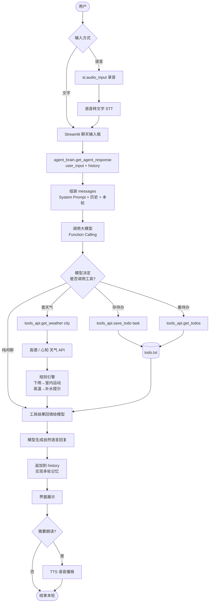
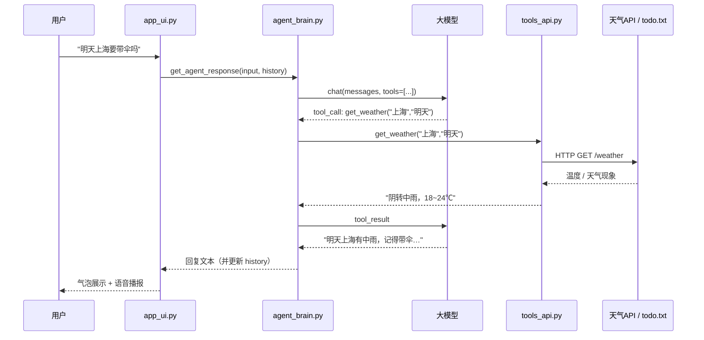
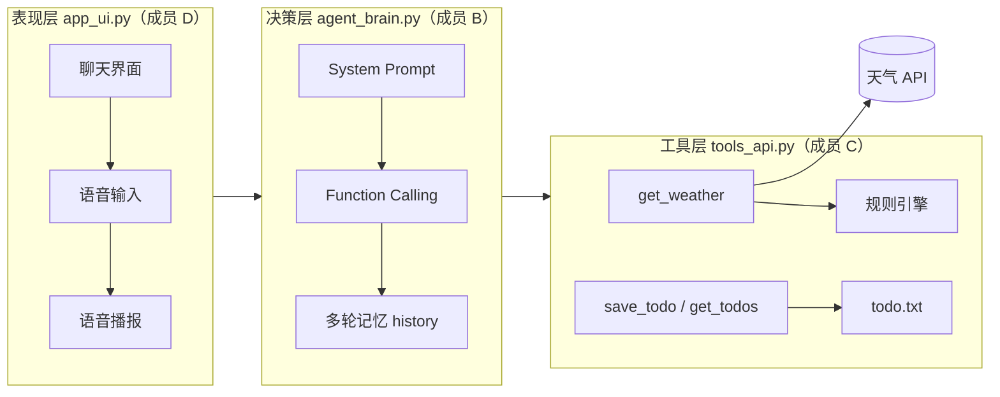

# 小智管家 · 智能生活助手 Agent

> 一个「**会说**也会**做**」的生活管家智能体：用自然语言聊天，同时能**查天气**、**读写待办**、**记住上下文**、**用语音交流**。
> 本文档即作业要求的 Agent 说明文档，包含需求描述、业务流描述、实现说明、使用示例、分工与心得。

<p align="left">
  
  
  
</p>

**目录**

- [一、需求描述](#一需求描述)
- [二、业务流描述](#二业务流描述)
- [三、实现说明](#三实现说明)
- [四、使用示例](#四使用示例)
- [五、GitHub 仓库](#五github-仓库)
- [六、小组分工](#六小组分工)
- [七、成员心得](#七成员心得)
- [八、学习资源推荐](#八学习资源推荐)

---

## 一、需求描述

### 1.1 项目背景与痛点

日常生活中的两类小事最容易被拖延：

1. **出门前要判断穿什么、带不带伞** —— 得打开天气 App，看温度、看降水，再自己推结论；
2. **临时想到的事要记下来** —— 得打开备忘录、新建一条、保存，步骤繁琐，往往"想到了但没记"。

现有的天气 App 和待办 App 各自只做一件事，用户需要在多个 App 之间来回切换。我们想要的是一个**入口唯一**的助手：像跟人说话一样把需求说清楚，它自己判断该干什么、并真的把事做掉。

这正是 **AI Agent（智能体）** 与普通聊天机器人的本质区别：聊天机器人只会"说"，Agent 还要"做"——由大模型自主决定调用哪个工具，而不是由代码里写死的 `if-else` 分支来决定。

### 1.2 目标用户与使用场景

| 目标用户 | 典型场景 |
|---|---|
| 学生 / 上班族 | 出门前问"今天上海要带伞吗"；上课路上说"提醒我下午三点交实验报告" |
| 经常出差的人 | "明天下雨的话帮我把行程改成室内" |
| 记性不太好的人 | "我这周攒了哪些待办？" |
| 不习惯打字的人 | 用语音说一句话完成以上所有操作 |

### 1.3 功能需求（"能说" + "会做"）

| 编号 | 功能 | 类型 | 描述 | 验收标准 |
|---|---|---|---|---|
| **F1** | 自然语言多轮对话 | 🗣 能说 | 支持任意话题闲聊，语气自然；能理解上下文追问（如先问"北京天气"，再问"那明天呢"） | 连续 5 轮对话不丢上下文 |
| **F2** | 天气查询与出行建议 | 🔧 会做 | 按城市 + 日期查询天气，并给出穿衣/带伞/出行建议 | 调用真实外部 API，返回温度、天气现象、建议 |
| **F3** | 待办与备忘读写 | 🔧 会做 | 语音或文字添加待办、查看全部待办，落地到本地文件持久化 | 重启程序后待办仍在 |
| **F4** | 规则化生活建议 | 🔧 会做 | 下雨天自动推荐室内运动，高温提醒补水等（规则写在工具层） | 命中规则时建议内容变化 |
| **F5** | 语音输入与播报 | 🗣 加分 | 支持语音输入转文字；回复可朗读 | 说出"帮我记一条…"能被正确识别 |

### 1.4 非功能需求

| 维度 | 要求 |
|---|---|
| **易用性** | 打开网页即可对话，无需安装客户端；首屏给出示例问题引导 |
| **响应时间** | 普通对话 ≤ 5 s；含工具调用 ≤ 10 s，超时给出明确提示而非卡死 |
| **可靠性** | 天气 API 失败、模型超时、Key 缺失等异常均降级为中文提示，程序不崩溃 |
| **安全性** | 所有密钥经 `.env` 注入，仓库中只保留 `.env.example`；`.env` 已被 `.gitignore` 排除 |
| **可移植性** | Windows / macOS / Linux 均可运行，依赖由 `requirements.txt` 统一管理 |
| **可维护性** | 界面、模型、工具三层解耦，一人一文件，互不冲突 |

### 1.5 加分项覆盖

| 加分项 | 覆盖情况 | 对应功能 |
|---|---|---|
| 多轮对话记忆 | ✅ | F1 —— 会话 `history` 全量随请求上送 |
| 语音输入 / 输出 | ✅ | F5 —— `st.audio_input` + 语音识别 / TTS 播报 |
| 外部 API 或数据库交互 | ✅ | F2 —— 调用高德（或心知/和风）天气 API |
| 简洁的前端界面 | ✅ | 全站 —— Streamlit 聊天式界面 |

---

## 二、业务流描述

### 2.1 总体业务流程图



> 高清图见 [`docs/workflow.mmd`](docs/workflow.mmd)，可复制到 <https://mermaid.live> 导出 PNG 供博客使用。

### 2.2 主流程

1. 用户在网页聊天框输入文字，或按住录音按钮说一句话；
2. 界面层把输入交给 `agent_brain.get_agent_response(user_input, history)`；
3. Agent 组装请求：`System Prompt`（人设 + 工具说明）+ 历史对话 + 本轮用户输入；
4. 大模型判断意图：**纯闲聊**则直接生成回复；**有明确任务**则发起 Function Calling；
5. 工具层执行真实操作：请求天气 API 或读写 `todo.txt`，并按规则补充生活建议；
6. 工具结果回填给大模型，由模型组织成自然、口语化的中文回复；
7. 本轮对话写入 `history`，界面展示回复，可选语音播报。

### 2.3 时序图



### 2.4 分支流程

| 分支 | 触发条件 | 处理 |
|---|---|---|
| 天气分支 | 命中"天气/温度/下雨/穿什么"等意图 | 调 `get_weather`；命中规则时追加建议 |
| 备忘写入 | 命中"记一下/提醒我/待办"等意图 | 调 `save_todo`，回复确认 + 当前待办条数 |
| 备忘读取 | "我有哪些待办" | 调 `get_todos`，列表化输出 |
| 闲聊分支 | 无工具意图 | 模型直接生成带人设的回复 |

### 2.5 异常流

| 异常 | 表现 | 处理策略 |
|---|---|---|
| 没给城市 | "今天天气怎么样" | Agent 反问："你在哪个城市呀？" |
| 城市不存在 | "查一下火星天气" | 提示"没查到这个城市，换个名字试试？" |
| API Key 无效 / 未配置 | 请求 401 | 提示"天气服务暂时不可用"，闲聊照常 |
| API 超时 / 网络异常 | 请求超时 | 8 s 超时后回复"网络有点慢，稍后再试"；程序不崩 |
| 待办文件不存在 | 首次运行 | 自动创建空 `todo.txt`，返回"目前还没有待办" |
| 模型调用失败 | 401 / 429 | 提示检查 `.env` 或稍后重试，保留上一轮界面 |

---

## 三、实现说明

> 🚧 本章由 **成员 B / C / D** 在 Day 4 前补全，成员 A 负责统稿。以下为待填结构。

### 3.1 技术选型

| 层 | 选型 | 理由 |
|---|---|---|
| 界面 | Streamlit | 纯 Python 写网页，天然支持聊天组件与录音控件 |
| 大模型 | DeepSeek（OpenAI 协议兼容） | 中文好、支持 Function Calling、有免费额度 |
| 工具 | requests + 本地文件 | 天气走外部 API，待办落地为纯文本，零数据库部署成本 |
| 配置 | python-dotenv | 密钥与代码分离 |

### 3.2 系统架构



### 3.3 模块划分

| 文件 | 负责人 | 职责 | 对外接口 |
|---|---|---|---|
| `agent_brain.py` | 成员 B | System Prompt、意图识别、多轮记忆 | `get_agent_response(user_input, history) -> str` |
| `tools_api.py` | 成员 C | 天气查询、待办读写、规则匹配 | `get_weather(city, date)` / `save_todo(task)` / `get_todos()` |
| `app_ui.py` | 成员 D | 聊天界面、语音输入输出 | `streamlit run app_ui.py` |

### 3.4 关键实现：工具调用（Function Calling）

> 🚧 待补充：工具 JSON Schema 定义、`tool_calls` 解析与回填代码片段。

### 3.5 关键实现：多轮对话记忆

> 🚧 待补充：`history` 列表结构（`[{"role","content"}, ...]`）、长度截断策略、与界面 `st.session_state` 的配合。

### 3.6 System Prompt 设计

> 🚧 待补充：完整 Prompt 原文 + 设计思路（人设、边界、何时调工具的约束）。

### 3.7 与 MCP 的对应关系

本项目的"**工具注册 + 模型自主调度**"这层抽象，与 Model Context Protocol（MCP）的设计思想一致：

| MCP 概念 | 本项目对应物 |
|---|---|
| MCP Server | `tools_api.py`（提供能力的一方） |
| Tool 定义（name / description / inputSchema） | 每个工具函数的签名 + 交给模型的 JSON Schema |
| MCP Client / Host | `agent_brain.py` + `app_ui.py` |
| Tool Call / Result | Function Calling 的 `tool_calls` 与 `tool` 消息 |

后续可平滑迁移：把 `tools_api.py` 包一层 MCP Server，工具就能被任意支持 MCP 的客户端复用。

---

## 四、使用示例

> 🚧 本章由 **成员 D**（截图 / GIF）+ **成员 A**（排版）在 Day 5 前完成。

### 4.1 环境准备与启动

```bash
# 1. 克隆仓库
git clone https://github.com/<owner>/<repo>.git
cd <repo>

# 2. 安装依赖
pip install -r requirements.txt

# 3. 配置密钥（把 .env.example 复制成 .env 并填值）
cp .env.example .env

# 4. 启动
streamlit run app_ui.py
```

### 4.2 演示一：查天气

> 🚧 待插入截图：``

### 4.3 演示二：添加待办

> 🚧 待插入截图：``

### 4.4 演示三：多轮追问

> 🚧 待插入截图：``

### 4.5 演示四：语音交互

> 🚧 待插入 GIF：``

---

## 五、GitHub 仓库

**仓库地址**：<https://github.com/LB-CC-summer/ai-agent-life-butler>

> 🚧 仓库地址在创建后由成员 A 确认更新。

---

## 六、小组分工

| 成员 | 角色 | 负责文件 | 主要工作 |
|---|---|---|---|
| **成员 A** | 项目统筹 & 文档架构 | `docs.md`、`README.md`、`requirements.txt`、`.env.example`、`.gitignore` | 建仓、画业务流程图、写需求与业务流、分发 Key、排版与发布博客园、最终合并审查 |
| **成员 B** | 大模型核心 & 记忆 | `agent_brain.py` | System Prompt、Function Calling 调度、多轮对话记忆 |
| **成员 C** | 工具函数开发 | `tools_api.py` | 天气 API 接入、待办文件读写、规则化生活建议 |
| **成员 D** | 前端界面 & 语音 | `app_ui.py` | Streamlit 聊天界面、语音输入、语音播报、演示视频/GIF |
| **成员 E** | 测试 & 博客发布 | 测试用例、博客终稿 | 黑盒测试与 Bug 跟踪、心得汇总、博客园排版与发布 |

> 🚧 待补充：各成员姓名、学号。

---

## 七、成员心得

> 🚧 待补充：每位成员 200 字以上，由 **成员 E** 汇总。

<details>
<summary>成员 A</summary>

（待填）

</details>

<details>
<summary>成员 B</summary>

（待填）

</details>

<details>
<summary>成员 C</summary>

（待填）

</details>

<details>
<summary>成员 D</summary>

（待填）

</details>

<details>
<summary>成员 E</summary>

（待填）

</details>

---

## 八、学习资源推荐

### 官方与课程资源

| 资源 | 说明 |
|---|---|
| [MCP 官方文档](https://modelcontextprotocol.io/) | Model Context Protocol 规范与快速入门，理解"工具如何被模型调用"的标准做法 |
| [MCP 官方 GitHub](https://github.com/modelcontextprotocol) | 官方 SDK 与示例 Server |
| [动手学多智能体系统实战教程 · Hello-Agents](https://github.com/datawhalechina/hello-agents) | 从单 Agent 到多 Agent 的系统性教程，含大量可运行示例 |
| [MCP 协议深度解析与实战应用](https://juejin.cn/) | 中文深度解析，讲清协议握手、工具发现与调用链路 |
| [OpenAI Function Calling 指南](https://platform.openai.com/docs/guides/function-calling) | 本项目工具调用的直接依据 |
| [Streamlit 官方文档](https://docs.streamlit.io/) | 聊天组件 `st.chat_message` / `st.chat_input` / `st.audio_input` |

### 平台与工具

| 资源 | 说明 |
|---|---|
| [文心智能体平台](https://agents.baidu.com/) | 零代码体验智能体搭建，适合快速建立直觉 |
| [阿里云百炼](https://bailian.console.aliyun.com/) | 通义千问 + 工具调用，国内可直接申请 Key |
| [DeepSeek 开放平台](https://platform.deepseek.com/) | 本项目采用的大模型服务，便宜且兼容 OpenAI SDK |
| [高德开放平台](https://lbs.amap.com/) | 天气查询 API（Web 服务类型 Key） |
| [Mermaid Live Editor](https://mermaid.live/) | 把 `docs/workflow.mmd` 导出为 PNG，供博客园使用 |

---

## 附录

| 项 | 内容 |
|---|---|
| 课程 | 🚧 待填 |
| 班级 | 🚧 待填 |
| 小组 | 🚧 待填 |
| 成员 | 🚧 待填 |
| 完成日期 | 2026-10 |

---

<sub>本文档由成员 A 维护；各章节标注了负责人与截止时间，请勿跨章节直接改写他人内容。</sub>
