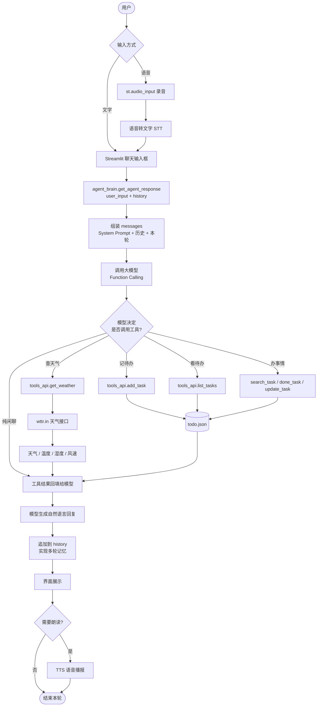
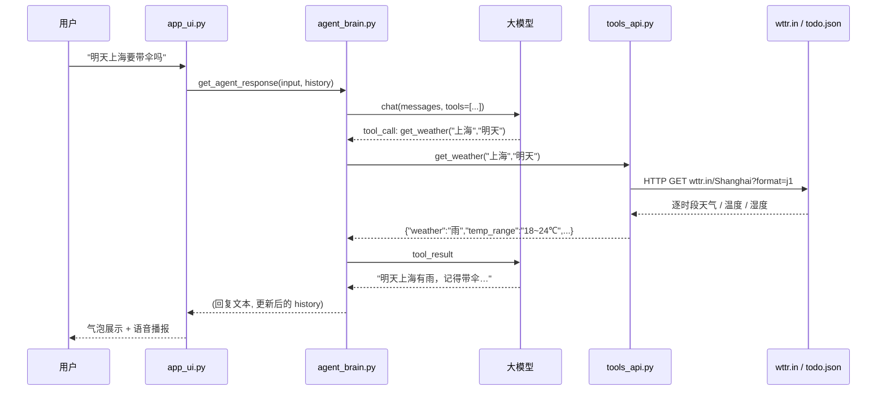
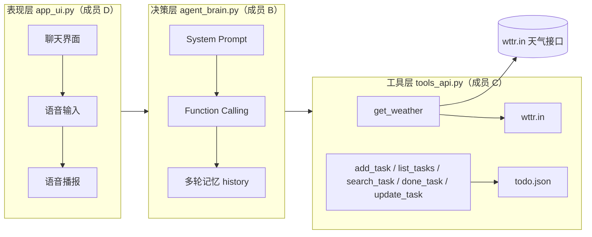

# 小智管家 · 智能生活助手 Agent

> 一个「**会说**也会**做**」的生活管家智能体：用自然语言聊天，同时能**查天气**、**读写待办**、**记住上下文**、**用语音交流**。
> 本文档即作业要求的 Agent 说明文档，包含需求描述、业务流描述、实现说明、使用示例、分工与心得。

<p align="left">
  
  
  
</p>

**目录**

- [一、需求描述](#一需求描述)
- [二、业务流描述](#二业务流描述)
- [三、实现说明](#三实现说明)
- [四、使用示例](#四使用示例)
- [五、GitHub 仓库](#五github-仓库)
- [六、小组分工](#六小组分工)
- [七、成员心得](#七成员心得)
- [八、学习资源推荐](#八学习资源推荐)

---

## 一、需求描述

### 1.1 项目背景与痛点

日常生活中的两类小事最容易被拖延：

1. **出门前要判断穿什么、带不带伞** —— 得打开天气 App，看温度、看降水，再自己推结论；
2. **临时想到的事要记下来** —— 得打开备忘录、新建一条、保存，步骤繁琐，往往"想到了但没记"。

现有的天气 App 和待办 App 各自只做一件事，用户需要在多个 App 之间来回切换。我们想要的是一个**入口唯一**的助手：像跟人说话一样把需求说清楚，它自己判断该干什么、并真的把事做掉。

这正是 **AI Agent（智能体）** 与普通聊天机器人的本质区别：聊天机器人只会"说"，Agent 还要"做"——由大模型自主决定调用哪个工具，而不是由代码里写死的 `if-else` 分支来决定。

### 1.2 目标用户与使用场景

| 目标用户 | 典型场景 |
|---|---|
| 学生 / 上班族 | 出门前问"今天上海要带伞吗"；上课路上说"提醒我下午三点交实验报告" |
| 经常出差的人 | "明天下雨的话帮我把行程改成室内" |
| 记性不太好的人 | "我这周攒了哪些待办？" |
| 不习惯打字的人 | 用语音说一句话完成以上所有操作 |

### 1.3 功能需求（"能说" + "会做"）

| 编号 | 功能 | 类型 | 描述 | 验收标准 |
|---|---|---|---|---|
| **F1** | 自然语言多轮对话 | 🗣 能说 | 支持任意话题闲聊，语气自然；能理解上下文追问（如先问"北京天气"，再问"那明天呢"） | 连续 5 轮对话不丢上下文 |
| **F2** | 天气查询与出行建议 | 🔧 会做 | 按城市 + 日期（今天/明天/后天/周五）查询天气，返回逐时段天气、温度区间、湿度、风速 | 调用真实外部接口并返回上述数据 |
| **F3** | 待办添加与查看 | 🔧 会做 | 自然语言添加待办，自动把"周五""明天"解析成日期；按状态查看清单 | 重启程序后待办仍在 |
| **F4** | 待办全生命周期管理 | 🔧 会做 | 关键词搜索、标记完成、修改内容或日期、清理已完成 | 逾期 / 今天截止 / 未到期 状态正确 |
| **F5** | 语音输入与播报 | 🗣 加分 | 按住说话自动转文字；回复可用浏览器语音合成朗读 | 说出"帮我记一条…"能被正确识别 |

### 1.4 非功能需求

| 维度 | 要求 |
|---|---|
| **易用性** | 打开网页即可对话，无需安装客户端；首屏给出示例问题引导 |
| **响应时间** | 普通对话 ≤ 5 s；含工具调用 ≤ 10 s，超时给出明确提示而非卡死 |
| **可靠性** | 天气 API 失败、模型超时、Key 缺失等异常均降级为中文提示，程序不崩溃 |
| **安全性** | 所有密钥经 `.env` 注入，仓库中只保留 `.env.example`；`.env` 已被 `.gitignore` 排除 |
| **可移植性** | Windows / macOS / Linux 均可运行，依赖由 `requirements.txt` 统一管理 |
| **可维护性** | 界面、模型、工具三层解耦，一人一文件，互不冲突 |

### 1.5 加分项覆盖

| 加分项 | 覆盖情况 | 对应功能 |
|---|---|---|
| 多轮对话记忆 | ✅ | F1 —— `history` 随请求上送，滑动窗口保留 20 条 |
| 语音输入 / 输出 | ✅ | F5 —— `st.audio_input` + 语音识别；浏览器 `speechSynthesis` 朗读 |
| 外部 API 或数据库交互 | ✅ | F2 —— 调用 wttr.in 天气公共接口；F3/F4 —— 本地 JSON 持久化 |
| 简洁的前端界面 | ✅ | 全站 —— Streamlit 聊天气泡 + 侧边栏待办面板 |

---

## 二、业务流描述

### 2.1 总体业务流程图



> 高清图见 [`docs/workflow.mmd`](docs/workflow.mmd)，可复制到 <https://mermaid.live> 导出 PNG 供博客使用。

### 2.2 主流程

1. 用户在网页聊天框输入文字，或按住侧边栏的录音按钮说一句话；
2. 界面层把输入交给 `agent_brain.get_agent_response(user_input, history)`；
3. Agent 组装请求：`System Prompt`（人设 + 工具使用规范）+ 历史对话 + 本轮用户输入；
4. 大模型判断意图：**纯闲聊**则直接生成回复；**有明确任务**则发起 Function Calling；
5. 工具层执行真实操作：请求 wttr.in 天气接口，或读写本地 `todo.json`；
6. 工具结果以 `role: "tool"` 回填给大模型，由模型组织成口语化的中文回复与生活建议；
7. 本轮对话写入 `history`（只存纯文本，滑动窗口保留 20 条），界面展示回复，可选语音播报。

### 2.3 时序图



### 2.4 分支流程

| 分支 | 触发条件 | 处理 |
|---|---|---|
| 天气查询 | "天气/温度/下雨/穿什么" | 调 `get_weather`；模型据返回的天气与温差自行给出建议 |
| 待办新增 | "记一下/提醒我/待办" | 调 `add_task`，自动解析截止日期并回复确认 |
| 待办查看 | "我有哪些待办" | 调 `list_tasks`，按逾期/今天/未到期列表化输出 |
| 待办操作 | "把交作业那条标完成""改到周六" | 先 `search_task` 拿 ID，再 `done_task` / `update_task` |
| 闲聊分支 | 无工具意图 | 模型直接生成带人设的回复 |

### 2.5 异常流

| 异常 | 表现 | 处理策略 |
|---|---|---|
| 没给城市 | "今天天气怎么样" | System Prompt 强制反问："你在哪个城市呀？"；工具层缺省值兜底为北京 |
| 日期越界 | 查询 3 天以后的天气 | 工具返回"超出预测范围"，模型转述给用户 |
| 城市不存在 | "查一下火星天气" | 接口无 `weather` 字段 → 返回"查询失败，请检查城市名" |
| 天气接口超时 / 网络异常 | wttr.in 无响应 | 8 s 超时，返回"网络异常：..."，程序不崩 |
| 待办文件不存在 | 首次运行 | `_load_tasks()` 返回空列表，提示"当前没有待办事项" |
| 待办 ID 非数字 | "把 abc 标记完成" | 返回"任务 ID 必须是数字"，不抛异常 |
| 大模型 Key 未配置 | 请求 401 | 界面顶部横幅提前提示 + 回复话术提示检查 `.env`，页面不白屏 |
| 模型限流 | 429 | 提示"被限流了，等几秒再问" |

---

## 三、实现说明

### 3.1 技术选型

| 层 | 选型 | 理由 |
|---|---|---|
| 界面 | Streamlit ≥ 1.40 | 纯 Python 写网页，原生支持 `st.chat_message` / `st.chat_input` / `st.audio_input` |
| 大模型 | DeepSeek（OpenAI 协议兼容，`openai` SDK） | 中文好、支持 Function Calling、价格低 |
| 天气 | wttr.in 公共接口 | **免费、免 Key**，一个 GET 就能拿到逐时段天气与温度，省掉申请高德 Key 的门槛 |
| 待办存储 | 本地 `todo.json` | 零部署成本；JSON 结构便于带 id / 截止日期 / 完成状态 |
| 语音 | `st.audio_input` + SpeechRecognition；浏览器 `speechSynthesis` | 识别走麦克风录音，朗读走前端 JS，不依赖服务器声卡 |
| 配置 | python-dotenv | 密钥与代码分离 |

### 3.2 系统架构



### 3.3 模块划分

| 文件 | 负责人 | 职责 | 对外接口（实际签名） |
|---|---|---|---|
| `agent_brain.py` | 成员 B | System Prompt、Function Calling 闭环、多轮记忆 | `get_agent_response(user_input, history) -> (reply, history)` |
| `tools_api.py` | 成员 C | 天气查询、待办 CRUD、自然语言日期解析 | `get_weather(city, date) -> dict`、`add_task` / `list_tasks` / `search_task` / `done_task` / `update_task` / `clear_done_tasks`，全部返回 dict |
| `app_ui.py` | 成员 D（整合：成员 A） | 聊天界面、待办面板、语音输入与朗读 | `streamlit run app_ui.py` |

> 详细字段说明见 [`docs/接口约定.md`](docs/接口约定.md)。

### 3.4 关键实现：工具调用（Function Calling）

核心是让**模型自己决定调哪个工具**，而不是在代码里写 `if "天气" in text`。三步：

**① 把 Python 函数描述成 JSON Schema**（`agent_brain.build_tools()`）

```python
{"type": "function", "function": {
    "name": "get_weather",
    "description": "查询指定城市天气，支持自然语言日期（如'明天'）。",
    "parameters": {"type": "object",
        "properties": {
            "city_name": {"type": "string", "description": "城市名"},
            "query_date": {"type": "string", "description": "日期，如'今天'、'明天'、'周五'"}
        },
        "required": ["city_name"]}}}
```

**② 循环处理工具调用**，直到模型不再要求调工具

```python
while True:
    response = client.chat.completions.create(model=MODEL, messages=messages,
                                              tools=build_tools(), tool_choice="auto")
    message = response.choices[0].message
    if message.tool_calls:                       # 模型要动手
        messages.append({"role": "assistant", "content": message.content or "",
                         "tool_calls": [tc.model_dump() for tc in message.tool_calls]})
        for tc in message.tool_calls:            # 逐个执行并回填结果
            args = json.loads(tc.function.arguments or "{}")
            result = call_tool(tc.function.name, args)
            messages.append({"role": "tool", "tool_call_id": tc.id,
                             "content": json.dumps(result, ensure_ascii=False)})
        continue                                 # 回去让模型继续思考
    return message.content, trim_history(history)
```

**③ 用 `while` 循环而不是单次调用**，是因为一次请求可能需要连续调多个工具。例如"把交作业那条标完成"：模型先 `search_task("作业")` 拿到 id，再 `done_task(3)`，两次工具调用在同一轮对话内完成。

### 3.5 关键实现：多轮对话记忆

`history` 就是一个纯文本消息列表，每轮把新的 user / assistant 两条追加进去：

```python
history = [
    {"role": "user",      "content": "明天上海要带伞吗"},
    {"role": "assistant", "content": "明天上海有雨，记得带伞…"},
]
```

三个关键设计：

1. **只存纯文本**。`tool_calls` / `role: "tool"` 这些中间消息**不写进 history**（只在当轮 `messages` 里存在）。否则下一轮再发给模型时，会因为 `tool_call_id` 找不到配对而报 400。
2. **滑动窗口**。`MAX_HISTORY_MESSAGES = 20`，超过就从头 `pop(0)`，约等于记住最近 10 轮，控制 token 消耗。
3. **界面层传副本**。`get_agent_response` 会直接 append 修改传入的列表，界面用 `list(st.session_state.history)` 传副本，失败时原历史不被污染。

### 3.6 System Prompt 设计

```text
你是"贴心的大学生生活管家"，一位热心又靠谱的同学。
【核心技能与工具调用规则】
1. 查天气：调用 get_weather。用户没说日期默认查今天，说'明天/周五'就传对应参数。
   收到工具返回的天气和温度后，请你自己发挥，给出一句温暖的出行、穿衣或运动建议，
   不要生硬地念数据。
2. 记待办：调用 add_task。务必从用户话中提取截止时间（如'周五'、'明天'）传给 due_date，没提就留空。
3. 查待办：调用 list_tasks。工具会返回任务状态（已逾期/今天截止/未到期），请据此提醒用户。
4. 完成任务：调用 done_task。如果用户只说事情名字，必须先用 search_task 搜出 ID，再调 done_task。
5. 修改任务：调用 update_task。用户说'改到周六'时使用。
【语气】像同寝室的同学一样亲切、口语化。如果用户没说城市，查天气前必须先反问！
```

设计要点：

| 要点 | 做法 | 效果 |
|---|---|---|
| 人设 | "贴心的大学生生活管家" | 回复口语化，不像客服 |
| 工具使用规则 | 每条工具写清"什么时候调、参数怎么取" | 减少漏调 / 乱调 |
| 强制约束 | "没说城市必须先反问" | 避免默认查北京，体验更好 |
| 让模型发挥 | "自己发挥给一句建议，不要生硬念数据" | 回复自然，不是数据复读机 |
| 多步任务 | "必须先用 search_task 搜出 ID" | 支撑"把交作业那条标完成"这类指令 |

### 3.7 与 MCP 的对应关系

本项目的"**工具注册 + 模型自主调度**"这层抽象，与 Model Context Protocol（MCP）的设计思想一致：

| MCP 概念 | 本项目对应物 |
|---|---|
| MCP Server | `tools_api.py`（提供能力的一方） |
| Tool 定义（name / description / inputSchema） | `build_tools()` 里每个函数的 JSON Schema |
| MCP Client / Host | `agent_brain.py`（调度）+ `app_ui.py`（宿主界面） |
| Tool Call / Result | Function Calling 的 `tool_calls` 与 `role: "tool"` 消息 |

后续可平滑迁移：把 `tools_api.py` 再包一层 MCP Server（暴露 `get_weather` 等为 MCP tools），同一批工具就能被 Claude Desktop、Cursor 等任意 MCP 客户端复用，而我们只需替换 `call_tool()` 的实现。

---

## 四、使用示例

> 🚧 本章由 **成员 D**（截图 / GIF）+ **成员 A**（排版）在 Day 5 前完成。

### 4.1 环境准备与启动

```bash
# 1. 克隆仓库
git clone https://github.com/LB-CC-summer/ai-agent-life-butler.git
cd ai-agent-life-butler

# 2. 安装依赖
pip install -r requirements.txt

# 3. 配置密钥：复制模板后填上自己的 DEEPSEEK_API_KEY
copy .env.example .env          # Windows
cp .env.example .env            # macOS / Linux

# 4. 启动
streamlit run app_ui.py
```

浏览器打开 <http://localhost:8501> 即可对话。天气无需申请 Key，待办自动存在本地 `todo.json`。

### 4.2 演示一：查天气

> 🚧 待插入截图：``

### 4.3 演示二：添加待办

> 🚧 待插入截图：``

### 4.4 演示三：多轮追问

> 🚧 待插入截图：``

### 4.5 演示四：语音交互

> 🚧 待插入 GIF：``

---

## 五、GitHub 仓库

**仓库地址**：<https://github.com/LB-CC-summer/ai-agent-life-butler>

```bash
git clone https://github.com/LB-CC-summer/ai-agent-life-butler.git
```

仓库为 **Public**，无需登录即可查看与克隆。

---

## 六、小组分工

| 成员 | 角色 | 负责文件 | 主要工作 |
|---|---|---|---|
| **成员 A** | 项目统筹 & 文档架构 | `docs.md`、`README.md`、`requirements.txt`、`.env.example`、`.gitignore` | 建仓、画业务流程图、写需求与业务流、分发 Key、排版与发布博客园、最终合并审查 |
| **成员 B** | 大模型核心 & 记忆 | `agent_brain.py` | System Prompt、Function Calling 调度、多轮对话记忆 |
| **成员 C** | 工具函数开发 | `tools_api.py` | 天气 API 接入、待办文件读写、规则化生活建议 |
| **成员 D** | 前端界面 & 语音 | `app_ui.py` | Streamlit 聊天界面、语音输入、语音播报、演示视频/GIF |
| **成员 E** | 测试 & 博客发布 | 测试用例、博客终稿 | 黑盒测试与 Bug 跟踪、心得汇总、博客园排版与发布 |

> 🚧 待补充：各成员姓名、学号。

---

## 七、成员心得

> 🚧 待补充：每位成员 200 字以上，由 **成员 E** 汇总。

<details>
<summary>成员 A</summary>

（待填）

</details>

<details>
<summary>成员 B</summary>

（待填）

</details>

<details>
<summary>成员 C</summary>

（待填）

</details>

<details>
<summary>成员 D</summary>

（待填）

</details>

<details>
<summary>成员 E</summary>

（待填）

</details>

---

## 八、学习资源推荐

### 官方与课程资源

| 资源 | 说明 |
|---|---|
| [MCP 官方文档](https://modelcontextprotocol.io/) | Model Context Protocol 规范与快速入门，理解"工具如何被模型调用"的标准做法 |
| [MCP 官方 GitHub](https://github.com/modelcontextprotocol) | 官方 SDK 与示例 Server |
| [动手学多智能体系统实战教程 · Hello-Agents](https://github.com/datawhalechina/hello-agents) | 从单 Agent 到多 Agent 的系统性教程，含大量可运行示例 |
| [MCP 协议深度解析与实战应用](https://juejin.cn/) | 中文深度解析，讲清协议握手、工具发现与调用链路 |
| [OpenAI Function Calling 指南](https://platform.openai.com/docs/guides/function-calling) | 本项目工具调用的直接依据 |
| [Streamlit 官方文档](https://docs.streamlit.io/) | 聊天组件 `st.chat_message` / `st.chat_input` / `st.audio_input` |

### 平台与工具

| 资源 | 说明 |
|---|---|
| [文心智能体平台](https://agents.baidu.com/) | 零代码体验智能体搭建，适合快速建立直觉 |
| [阿里云百炼](https://bailian.console.aliyun.com/) | 通义千问 + 工具调用，国内可直接申请 Key |
| [DeepSeek 开放平台](https://platform.deepseek.com/) | 本项目采用的大模型服务，便宜且兼容 OpenAI SDK |
| [高德开放平台](https://lbs.amap.com/) | 天气查询 API（Web 服务类型 Key） |
| [Mermaid Live Editor](https://mermaid.live/) | 把 `docs/workflow.mmd` 导出为 PNG，供博客园使用 |

---

## 附录

| 项 | 内容 |
|---|---|
| 课程 | 🚧 待填 |
| 班级 | 🚧 待填 |
| 小组 | 🚧 待填 |
| 成员 | 🚧 待填 |
| 完成日期 | 2026-10 |

---

<sub>本文档由成员 A 维护；各章节标注了负责人与截止时间，请勿跨章节直接改写他人内容。</sub>
